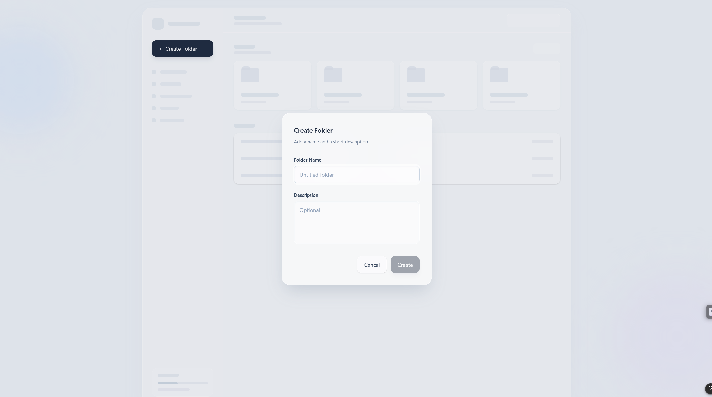
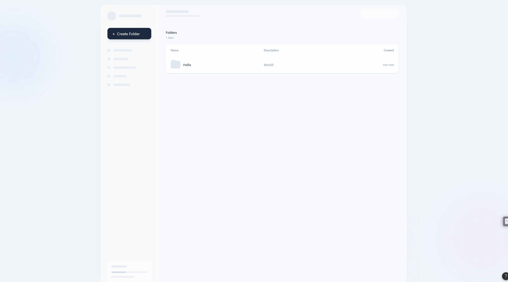

## Create Folder Design

_[←  back](./README.md)_

[figma link](https://www.figma.com/make/ERni0wkwR95GWOM2i3OucL/Create-Folder-Wireframe?t=J5wdt24sRo2udoil-1)

### Normal View

### With Modal opened

### After Creation
